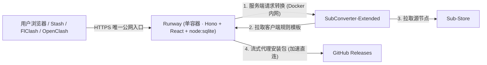

<div align="center">
  
  <h1>Runway</h1>
  <p><strong>极简自托管代理订阅分发门户 · 让每个人 30 秒一键起飞</strong></p>
  <p>
    构建在你已有的 <strong>Sub-Store</strong> 与 <strong>SubConverter-Extended</strong> 之上，<br/>
    把极客向的节点管理与规则转换，包装成普通用户开箱即用的下载与导入中心。
  </p>

  <p>
    
    
    
    
  </p>
</div>

---

## 为什么做 Runway？

如果你已经自建了 **Sub-Store** 管理订阅与节点，并用 **SubConverter-Extended** 做规则转换，把配置分享给家人或团队成员时，往往会遇到 4 个非常具体的痛点：

1. **上手门槛太高**：Sub-Store 和 SubConverter 都是极客工具，没法直接丢给不懂技术的用户，也无法给每人做独立账号隔离。
2. **安全与防泄漏难**：直接发 Sub-Store / SubConverter 拼接链接，容易泄露上游订阅源地址；一旦链接外传，很难单独吊销某一个人的权限。
3. **客户端安装包获取不便**：Windows / Android / OpenWrt 客户端安装包托管在 GitHub Releases，新设备直接访问 GitHub 下载往往速度慢或不稳定。
4. **多端规则维护分散**：Stash、FlClash、OpenClash 的转换参数和规则模板略有差异，改一次规则要重新发一遍链接。

**Runway 就是为了解决这 4 个问题而生的轻量「登机口」：**
它**不重复造轮子**——继续把节点管理交给 Sub-Store、把协议与规则转换交给 SubConverter-Extended，自己只做一层极薄、极稳、好看的门户与安全中转层。

---

## 核心架构



---

## 核心亮点

### 面向普通用户：30 秒傻瓜式上手
- **干净无干扰的门户页**：普通用户登录后完全看不到「管理后台」或底层技术细节，按设备选卡片即可。
- **原生适配主流客户端**：开箱内置 **Stash**（iOS/macOS）、**FlClash**（Windows/macOS/Android）、**OpenClash**（OpenWrt 软路由），后台也可自由扩展更多客户端。
- **站内高速直连下载 App**：点击即可直接通过你的服务器代理下载客户端安装包（支持断点续传），省去自行去 GitHub 找包和下载慢的烦恼。
- **三步完成导入**：下载软件 → 一键拉起导入（`stash://` / `clash://`）或手机扫码导入 → 简明步骤指引。

### 面向管理员：省心、安全、零膨胀
- **完全隐藏上游链接**：对外仅暴露 `/s/<user_token>/<client>`，用户永远看不到 Sub-Store 和 SubConverter 地址；支持随时停用账号或**一键重置订阅 Token**，旧链接立即失效。
- **按客户端在线管理规则模板**：在后台直接编辑 Stash / FlClash / OpenClash 各自的 SubConverter 规则模板（INI / YAML / TOML），改完即全员生效，并内置**在线测试转换**与 `explain=true` 诊断预览。
- **GitHub 最新版自动追踪代理**：安装包管理支持 4 种模式——
  1. **GitHub Latest Release 自动代理**（推荐）：填 `owner/repo` 与文件名匹配规则（支持一键预览资产列表），自动展示最新版本号并流式转发下载，**不占服务器磁盘、无需手动追更**；
  2. **固定直链流式代理**：粘贴任意安装包直链，经本站代理下载；
  3. **本地上传托管**：支持上传 `.exe` / `.dmg` / `.apk` / `.ipk` 到挂载卷（支持 `Range` 断点续传）；
  4. **外部跳转链接**：如 Stash 跳转 App Store。
- **拉取审计日志**：记录每次订阅拉取的用户、客户端、IP 与 User-Agent，异常外传一目了然。
- **极致轻量零编译**：基于 Node.js 原生内置 `node:sqlite`，**无任何 C++ 原生编译依赖**，单 Docker 容器运行，前端产物 gzip 仅 ~100 KB。

---

## 快速部署（Docker Compose）

> 前置条件：你已经部署好 **Sub-Store** 和 **[SubConverter-Extended](https://github.com/Aethersailor/SubConverter-Extended)**（同机 Docker 内网或公网可访问均可）。

### 1. 准备 `docker-compose.yml`

无需拉取源码编译，直接拉取多架构预构建镜像（支持 `linux/amd64` 与 `linux/arm64`）：

```bash
mkdir -p runway && cd runway
curl -fsSLO https://raw.githubusercontent.com/haoqianwei/runway/main/docker-compose.yml
```

编辑 [docker-compose.yml](docker-compose.yml)：
- 修改初始管理员账号密码 `ADMIN_USERNAME` / `ADMIN_PASSWORD`（也可登录后在右上角随时修改）；
- 如果 Sub-Store 和 SubConverter-Extended 位于同一台服务器的 Docker 网络中，取消 `networks` 注释并填入对应网络名。

### 2. 启动容器

```bash
docker compose up -d
```

> 如需更新到最新版本：执行 `docker compose pull && docker compose up -d`。

### 3. 四步完成初始化配置

浏览器访问 `http://<你的服务器>:3000`，用管理员账号登录并进入右上角 **管理后台**：

1. **系统设置**：填写 `SubConverter-Extended` 地址（点击「连通性检测」确认连通）、门户公网地址与内网回调地址（如 `http://runway:3000`）；如需高频调用 GitHub Release API，可选填 `GitHub Token`。
2. **客户端与规则模板**：分别为 Stash / FlClash / OpenClash 粘贴你的 SubConverter 规则模板，点击「测试转换」验证输出无误。
3. **安装包管理**：选择「GitHub 最新版代理」，例如填入 `chen08209/FlClash` 点击「预览资产」选中各平台安装包并保存；Stash 可使用内置的 App Store 链接。
4. **用户管理**：新建用户账号，绑定你在 Sub-Store 中为其准备好的订阅链接，把账号密码发给用户即可。

> **关于 `proxy-providers` 隐藏上游地址的提示**  
> 如果你的 SubConverter-Extended 输出包含 `proxy-providers` 且 Sub-Store 仅部署在内网，请在「客户端与规则模板」中将**源链接传递模式**设为 **`经本站 /raw 中转`**，或在额外查询参数中加上 `list=true` 内联节点，避免客户端直接请求内网地址导致拉取失败。

---

## 环境变量说明

| 变量名 | 默认值 | 说明 |
| :--- | :--- | :--- |
| `PORT` | `3000` | 服务监听端口 |
| `DATA_DIR` | `/data` | SQLite 数据库与本地上传安装包的持久化目录 |
| `ADMIN_USERNAME` | `admin` | 首次启动创建的默认管理员用户名 |
| `ADMIN_PASSWORD` | `changeme123` | 首次启动创建的默认管理员密码（仅首次初始化生效） |
| `SUBCONVERTER_URL` | `http://subconverter:25500` | SubConverter-Extended 地址（可在后台随时修改） |
| `INTERNAL_BASE_URL` | `http://runway:3000` | 供 SubConverter 回调读取模板的内网地址（可在后台修改） |
| `PUBLIC_BASE_URL` | *(自动识别)* | 门户公网访问地址，用于生成订阅链接与二维码 |
| `GITHUB_TOKEN` | *(空)* | 可选，提高 GitHub Release API 速率限制（可在后台修改） |
| `JWT_SECRET` | *(自动生成)* | 会话签名密钥，留空则首次启动自动生成并持久化到数据库 |
| `INTERNAL_SECRET` | *(自动生成)* | 内部模板回源校验密钥，留空则自动生成并持久化 |

---

## 技术栈与本地开发

- **前端**：Vite + React 19 + TypeScript + Tailwind CSS + Lucide Icons + `qrcode.react`
- **后端**：Hono + Node.js 24 (`node:sqlite`) + Drizzle ORM + Zod + `jose` + `bcryptjs`

本地开发需要 Node.js 22.5+（推荐 24 LTS）：

```bash
cp .env.example .env
npm install
npm run dev
```

- 后端 API：`http://127.0.0.1:3000`
- 前端开发服务：`http://127.0.0.1:5173`

### 类型检查、构建与端到端测试

```bash
npm run typecheck
npm test
npm run build
```

---

## 生态搭配

- 节点与订阅源管理：[Sub-Store](https://github.com/sub-store-org/Sub-Store)
- 多端规则与格式转换：[Aethersailor/SubConverter-Extended](https://github.com/Aethersailor/SubConverter-Extended)
